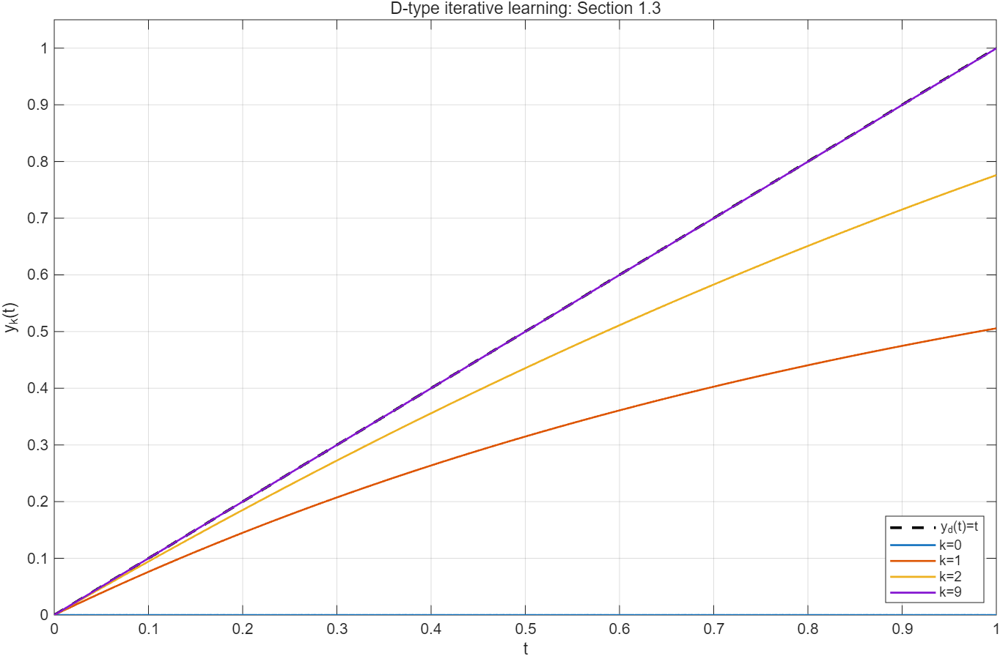
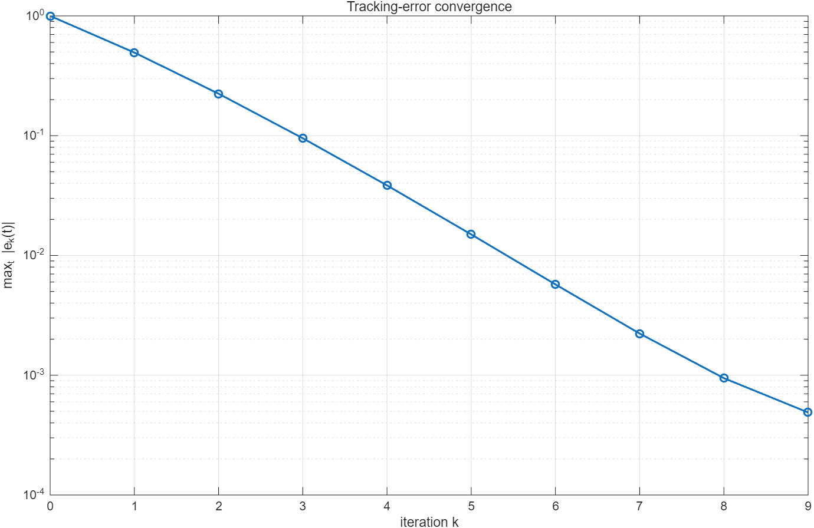

# 第一章 1.3：直流电机迭代学习控制仿真

本案例根据《迭代学习控制》第一章 1.3（印刷页 12–16）建立一阶模型，观察重复运行中输出如何逼近期望角速度轨迹。

## 模型与参数

$$\dot y_k(t)+a y_k(t)=b u_k(t),\qquad e_k(t)=y_d(t)-y_k(t).$$

书中参数为 `a=b=1`、`beta=1.25`、`T=1`、`y_d(t)=t`、`u_0(t)=0`。每次运行都从 `y_k(0)=0` 开始。

使用 D 型学习律：

$$u_{k+1}(t)=u_k(t)+\frac{1}{\beta}\dot e_k(t).$$

误差上方的点表示对时间求导。`|1-b/beta|=0.2<1` 满足书中的收敛参数条件；该数值不是每次误差范数的固定缩减比例。

## 运行

在仓库根目录的 MATLAB 命令窗口执行：

```matlab
run('chapter1/ilc_case_1_3.m')
```

已在 MATLAB R2025b 实际运行通过，不需要 Control System Toolbox 或 Simulink。运行后会在脚本目录生成两张 PNG 图片，并在命令窗口打印误差。

## 代码说明

| 代码 | 含义 |
| --- | --- |
| `clear; close all; clc;` | 清空变量、关闭旧图窗、清空命令窗口。 |
| `N=2000; K=9;` | 将一秒分成 2000 个时间区间；计算编号 0 到 9 的十次输出。 |
| `linspace(0,T,N+1).'` | 生成含两个端点的 2001 个采样时刻，并转成列向量。 |
| `dt=t(2)-t(1)` | 时间步长为 0.0005 秒。 |
| `yd=t; yd_dot=ones(size(t));` | 期望输出为斜坡，其导数恒为 1。 |
| `u=zeros(N+1,1)` | 第 0 次运行的输入恒为零。 |
| `y=zeros(N+1,K+1)` | 每行对应采样时刻，每列对应一次重复运行。 |
| `u_hist(:,k+1)=u` | 保存本次所用的完整输入轨迹。 |
| `plant_response(u,a,b,dt)` | 使用本次输入，计算从零初始状态出发的输出轨迹。 |
| `e(:,k+1)=yd-y(:,k+1)` | 计算本次全部采样点的跟踪误差。 |
| `y_dot=-a*y(:,k+1)+b*u` | 根据理想模型直接求输出导数。 |
| `e_dot=yd_dot-y_dot` | 求误差导数；不是误差本身。 |
| `u=u+e_dot/beta` | 根据 D 型学习律更新下一次运行的输入。 |
| `if k<K` | 最后一次输出计算完成后，无需再生成下一次输入。 |
| `max(abs(e),[],1)` | 沿时间维度取最大误差绝对值，每次运行得到一个数。 |
| `fprintf` | 输出参数和误差数值，`%d` 表示整数、`%e` 表示科学计数法。 |
| `plot_k=[0 1 2 9]` | 在轨迹图中选择书中显示的迭代编号。 |
| `k+1` | MATLAB 从 1 索引；编号 0 的运行保存在第 1 列。 |
| `lines`、`plot`、`hold on` | 分配曲线颜色并叠加绘图。 |
| `grid`、`box`、`xlim`、`ylim` | 设置网格、边框和显示范围。 |
| `xlabel`、`ylabel`、`title`、`legend` | 设置坐标说明、标题和图例。 |
| `semilogy` | 纵轴采用对数刻度，展示不同量级的误差。 |
| `fileparts(mfilename('fullpath'))` | 获取脚本目录，确保输出图保存位置明确。 |
| `exportgraphics` | 将当前图保存为 PNG。 |
| `assert` | 检查参数、初始状态、第一次解析解和误差收敛；不满足时直接报错。 |

`plant_response` 中假设每个采样区间输入保持不变，用精确递推模拟一阶系统：

$$y_{i+1}=\alpha y_i+g u_i,\quad\alpha=e^{-a\Delta t},\quad g=\frac{b(1-\alpha)}{a}.$$

`numel(u)` 是采样点总数；`y=zeros(n,1)` 也保证每次调用重新从零状态开始。内层 `i` 推进时间，外层 `k` 推进重复运行次数。

这是一项理想模型仿真：利用已知模型计算导数，而不是模拟带噪测量的微分器。实际电机的测量噪声、饱和、初始状态误差和微分滤波不包含在本案例中。

## 结果

| 迭代编号 | 最大跟踪误差 |
| --- | --- |
| 0 | 1.000000 |
| 1 | 0.494304 |
| 2 | 0.224109 |
| 9 | 0.000488847 |

第 9 次轨迹已接近期望轨迹，与图 1.3.2 的表现一致。初次非零输入为常数 `1/beta`，因此第一次输出可独立核验为 `y_1(t)=(1-exp(-t))/beta`。脚本对此解析解设置了数值断言。





## 关于早期版本的修正

先前本地脚本遗漏误差上方的导数符号，使用了 P 型更新 `u=u+e/beta`，因此第 9 次不能复现书中的结果。当前版本已改为书中的 D 型更新 `u=u+e_dot/beta`。早先将差异解释为书中示意图不精确的说法不成立。
