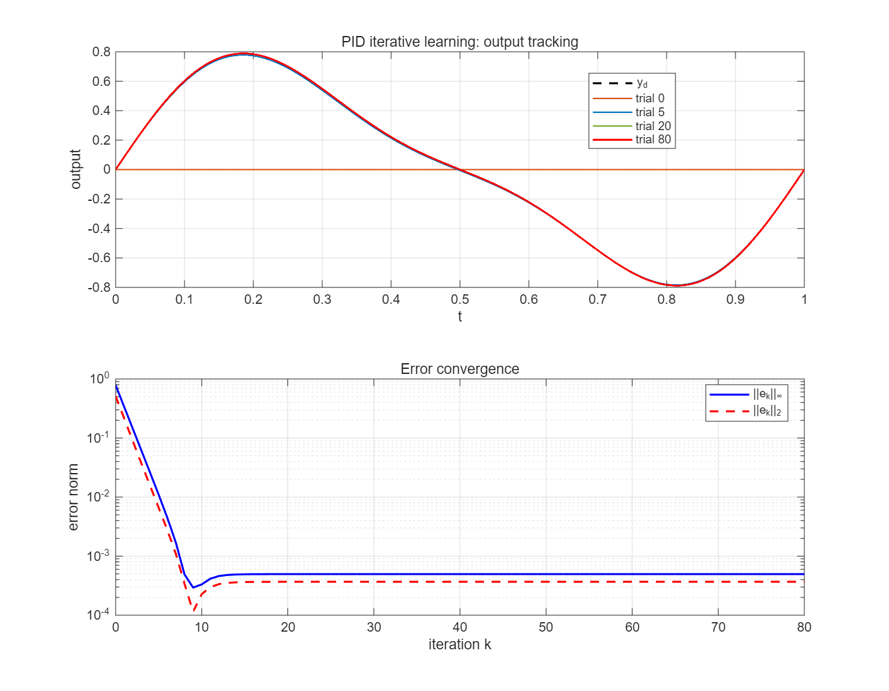
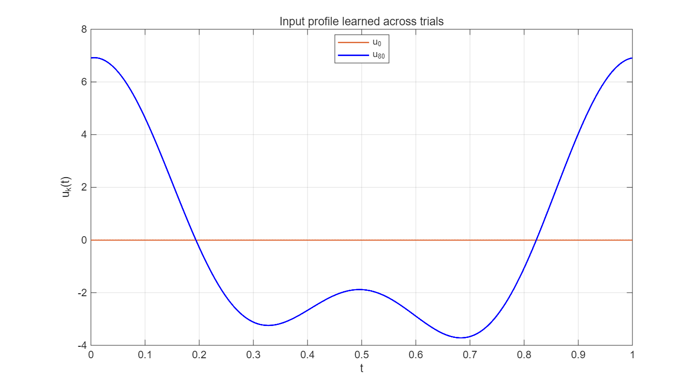

# 第二章：PID 型迭代学习控制

本目录包含第二章第 2.2 节 PID 型学习律的 MATLAB 仿真、结果图和运行说明：

\[
u_{k+1}(t)=u_k(t)+\Gamma\dot e_k(t)+Le_k(t)+\Psi\int_0^t e_k(\tau)\,d\tau.
\]

## 示例系统

\[
\dot{x}(t)=-0.5x(t)+u(t),\qquad y(t)=x(t).
\]

每次迭代使用相同初始状态 `x(0)=0`，期望轨迹满足 `y_d(0)=0`。参数为：

- `Gamma = 0.60`
- `L = 0.08`
- `Psi = 0.04`
- `rho(I-C*B*Gamma) = 0.40 < 1`

运行 `ilc_pid_validation.m` 即可得到输出跟踪曲线、误差收敛曲线和学习前后的输入曲线。80 次迭代后，仿真得到：

- `||e_0||_inf = 7.882291e-01`
- `||e_80||_inf = 4.960881e-04`
- `||e_0||_2 = 5.147815e-01`
- `||e_80||_2 = 3.678809e-04`

残余误差来自时间离散和零阶保持近似；加密时间网格后残余误差会继续下降。

## 运行方法

在 MATLAB 中将当前文件夹切换到本目录 `chapter2`，然后运行：

```matlab
ilc_pid_validation
```

脚本会在当前文件夹生成 `pid_ilc_validation.png` 和 `pid_ilc_input.png`。

## 文件与结果图

- [MATLAB 仿真脚本](ilc_pid_validation.m)
- [输出跟踪与误差收敛图](pid_ilc_validation.png)
- [输入学习曲线](pid_ilc_input.png)




